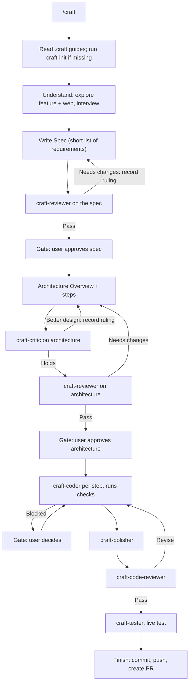

# craft

Shared coding workflows for Cursor, Codex, and Claude Code, maintained in one repository.

AI agents are great at producing code that *works* and bad at producing code that is clean, modular, readable, and idiomatic. `craft` fixes that by making the main agent the **planner**: it owns understanding, the spec, the architecture, and the plan, while focused subagents explore, review, implement, polish, and live-test. Each agent carries the standards verbatim in its own file; the orchestrator owns every gate and proves the finished feature by running it locally.

The `/craft` workflow is one elastic path: reuse shared repository guides, explore feature-specific gaps (plus web research for non-trivial architectures), interview, get the spec reviewed and approved, get the design and implementation plan reviewed and approved, implement hands-off, polish, review the full diff, and live-test. The user approves twice — the spec, then the design with its steps and test plan. A blocked coder comes back as a third gate.

Every run proves the feature live before creating the PR.

## What's inside

| Component | Type | Role |
|---|---|---|
| `craft` | skill (`/craft`) | Writes spec then architecture with a review and a user gate on each, then implements hands-off |
| `craft-init` | skill (`/craft-init`) | Initializes or refreshes reusable repository guides in `.craft/` |
| `craft-quick` | skill (`/craft-quick`) | Uses a small feature workspace, critic-loops the design, asks for approval, then builds and runs automated checks |
| `craft-design` | skill (`/craft-design`) | Mocks 3–5 UI directions in one Canvas, iterates to a chosen design, then implements the UI |
| `craft-test` | skill (`/craft-test`) | Proves a feature works by running it live; standalone or as craft's final step |
| `craft-monitor` | skill (`/craft-monitor`) | Checks a shipped feature against live production data; reports problems and improvements worth considering |
| `craft-research` | skill (`/craft-research`) | Breaks a topic into areas, researches each in parallel, and produces a refined doc in `Docs/` |
| `craft-paper` | skill (`/craft-paper`) | Drafts, edits, reviews, cites, and formats LaTeX research papers — numbers from the data, citations fetched by identifier, venue rules read fresh |
| `craft-refactor` | skill (`/craft-refactor`) | Recovers a behavior spec from existing code, generates a clean design from that spec, critic-loops it, then refactors without changing observable behavior |
| `craft-coder` | subagent | Implements one focused assignment into the repo |
| `craft-critic` | subagent (readonly) | Fresh-eyes design critic — steps back from the whole design, finds where it got overbuilt or went wrong, and proposes a simpler one or shows why it holds. Better design / Holds |
| `craft-code-reviewer` | subagent (readonly) | Fresh-context review of an implementation — Pass / Revise |
| `craft-polisher` | subagent | Restructures and polishes a working diff without changing observable behavior |
| `craft-tester` | subagent | Runs a feature live — verification, local process, real requests, screenshots — and returns per-criterion evidence |
| `craft-reviewer` | subagent (readonly) | Gates a spec or architecture before it is built — complete, correct, buildable as written. Needs changes / Pass |
| `craft-paper-reviewer` | subagent (readonly) | Fresh-context paper review — claims vs evidence, soundness, prior work, numbers vs data, venue fit. Ready / Revise |
| `craft-researcher` | subagent (readonly) | Deep web research — finds and fully reads authoritative sources, returns synthesized findings |

Each agent carries the standards verbatim; shared references (spec and architecture standards) live under `skills/craft/references/`.

## The workflow



### Artifacts it produces (in the target repo)

- `.craft/README.md` and the shared `conventions.md`, `development.md`, `testing.md`, `deployment.md`, `observability.md`, and `databases.md` — reusable project knowledge, initialized by `craft-init` and maintained as verified facts change.
- `.craft/<feature>/` — full `craft` feature workspace: `progress.md` is the resume entry point; `spec.md` owns requirements; `architecture.md` owns design; `implementation.md` owns build steps; `testing.md` owns planned checks and evidence. Add `research.md` when useful. Each document has a flexible Markdown template.
- `.craft/<task>/` — `craft-quick` uses the same document roles with a smaller set: `progress.md`, `architecture.md`, `implementation.md`, and `testing.md`. The request and completion criteria live in `architecture.md`; there is no separate spec. One approval covers the design, steps, and automated test plan.
- `docs/monitor/<feature>.md` — written by `craft-monitor`. How the feature works, how to reach its data, four to six checks as literal queries with their observed normal ranges, and the running log of findings.

### Shared repository guides

`craft-init` discovers the project map, conventions, setup and verification commands, deployment procedures, logs, and database access. Existing project instructions, docs, scripts, configuration, and skills are its starting point. It records sources and distinguishes documented instructions from commands or access actually verified. Unknown topics remain explicit; initialization does not require a deployment or production credentials.

When `.craft/README.md` is missing, code workflows run `craft-init`, then read the shared guides before planning. During work, workflows update durable repository facts in the shared files and keep feature decisions and evidence in the feature workspace. Brainstorming reads existing guides without writing them. Current project instructions and source evidence take precedence over cached notes.

Use `/craft-init refresh` to revisit the whole guide or `/craft-init refresh testing` for an area. Routine work fills relevant gaps and corrects changed facts; an old date alone does not trigger a full scan. Existing custom content is preserved.

Templates ship inside [craft-init](skills/craft-init/SKILL.md), [craft](skills/craft/SKILL.md), and [craft-quick](skills/craft-quick/SKILL.md). They provide concise default headings and prompts, with room to add, combine, reorder, or omit sections to suit the repository or feature. Keep the conventional filenames and each document's responsibility. Shared guides and feature workspaces are intended to be Git-tracked, subject to repository policy.

## Install and refresh

Keep one checkout at `~/.cursor/plugins/local/craft`. Cursor loads this directory directly. Codex and Claude Code use local marketplaces in the same repo and generated packages built from the same skills and agent prompts.

```bash
git clone git@github.com:AidenHadisi/craft.git ~/.cursor/plugins/local/craft
cd ~/.cursor/plugins/local/craft
python3 scripts/refresh.py
```

After every edit, run `python3 scripts/refresh.py` again. It builds both packages, refreshes Codex when its CLI is available, and installs or updates Claude Code when its CLI is available. Missing CLIs are reported and skipped. Reload Cursor and start new sessions to load changes.

For packaging only, use `python3 scripts/refresh.py --build-only`. To check that generated files match the source without modifying anything, use `python3 scripts/refresh.py --check`. Select just one installation with `--target codex` or `--target claude`.

Claude Code can also load the generated package directly for development:

```bash
claude --plugin-dir ~/.cursor/plugins/local/craft/.generated/claude
```

Claude plugin skills and agents are namespaced, for example `/craft:craft` and `craft:craft-coder`. Other hosts may display their own invocation syntax; the workflow names remain the same.

## One source of truth

Edit `skills/` and `agents/` only in this repo. Keep each skill’s supporting files inside its own folder; the build rejects local Markdown links that escape that folder or point to missing files. Plugin identity and version live in `.cursor-plugin/plugin.json`. The refresh script generates the Codex and Claude manifests from that metadata and converts the same agent prompts to each host's format. `.generated/` is disposable and ignored by Git; installed caches are never source files.

Codex's local marketplace points into this repo. Its eight personal agent definitions are links to generated TOML files here. The installer refuses to overwrite unrelated agent files; matching files from an earlier Craft installation can be replaced with links. Claude receives Markdown agents with translated metadata. Read-only roles keep explicit read-only instructions; Claude additionally disables direct file-edit tools. Shell and remote-tool restrictions still depend on the host's permissions.

Python 3.11 or newer is required; no third-party Python packages are needed.

The supported adapters are Cursor, Codex, and Claude Code. Other skill-capable hosts can reuse the Markdown workflows and prompts, but workflows requiring independent agents need a host with delegation support. `craft-design` uses Canvas when available and a local HTML mockup otherwise.

For a fresh clone, build the packages before adding either local marketplace. Generated packages are intended for local installation; publishing prebuilt packages is a separate release step.

## Usage

Initialize repository knowledge explicitly, or let a code workflow do it on first use:

```
/craft-init
/craft-init refresh development
```

```
/craft add OAuth login for the dashboard
```

You approve twice. First `spec.md` — observable requirements and scope — after `craft-reviewer` checks it. Then `architecture.md`, `implementation.md`, and the planned checks in `testing.md`, after `craft-critic` looks for a simpler design and `craft-reviewer` gates it. Substantive changes reopen the relevant approval. After design approval, implementation is hands-off: coders run the repo's checks; a blocked step comes back as a gate. Polish and `craft-code-reviewer` cover the full diff, then `craft-tester` proves every requirement in a real running process. The planner records progress and approvals in `progress.md` and verification evidence in `testing.md` before creating the PR.

Every `craft-*` agent is usable on its own, not only from a skill.

For a smaller change that needs design judgment without the full workflow:

```
/craft-quick add filtering to the audit log
```

It reuses the shared guides, explores relevant code, and asks questions only when blocked by a real decision. A concise `.craft/<task>/` workspace holds the request and design in `architecture.md`, steps in `implementation.md`, checks and results in `testing.md`, and approval and resume state in `progress.md`. Its templates adapt to the task. `craft-critic` checks the design until it holds; you approve the design, steps, and test plan once. Then one `craft-coder` builds it, runs automated checks, and hands the diff to `craft-polisher`. It creates no spec, branch, commit, PR, or live test.

For UI work, compare 3–5 mock directions in one Canvas, refine or combine them, then implement the one you pick:

```
/craft-design redesign the analytics dashboard
```

To clean up existing code rather than build something new, hand it a target and let it work:

```
/craft-refactor the payment reconciliation package
```

No interview — it explores the target, recovers a mostly non-technical spec of how the thing should work, and designs a simple modern solution from that spec. `craft-critic` loops that design until it holds (or hits the cap). Then it presents one recommendation as a single go/no-go gate. On approval, it refactors in small verified waves — observable behavior, public APIs, and wire shapes preserved — with `craft-code-reviewer` on the diff and `craft-polisher` finishing. If there is no narrow boundary, it steers the existing code toward the sketch instead of replacing it.

Once it ships, check on it. Standalone — invoke it whenever you want to know how something is behaving, whether craft built it or not:

```
/craft-monitor site-evaluation
```

The first invocation learns the feature — its tables, log streams, metrics, and the exact way to query each — and writes `docs/monitor/<feature>.md` with four to six checks. Run in the session that just built the feature, it reuses what's already in context and researches only the gaps. Either way every check is **run before it's written down**, so the recorded normal range is an observed value rather than a guessed threshold.

Every invocation after that follows the file: work the checks, compare each against its normal range and the log, then look around for what the checks don't cover. What comes back is problems and observations alike — a step eating the runtime or output that's weak for one kind of input is worth knowing even though nothing is broken. Most runs report nothing new, and that's the point: the bar is whether a person would want to know, not whether the agent found something to say.

## Design notes

- **Orchestrator owns architecture.** Spec, design, and plan stay in one context so decisions don't die in a handoff.
- **Delegation for labor.** Exploration, research, coding, review, and live testing use subagents; judgment stays with the orchestrator, and so does its context.
- **Standards in every agent.** Each agent carries the spec and design standards verbatim; shared references live under `skills/craft/references/`.
- **Critique, not consensus.** The critic searches for a simpler design or shows why the draft holds; the orchestrator records its rulings in the plan.
- **Diffs, not reports.** Coder reports are claims; `craft-code-reviewer` owns the Pass/Revise gate over the full diff — the orchestrator accepts findings, loops coders, and advances only on Pass.
- **Prove it runs.** Every run ends with static checks, then live testing — run locally under a test account, real data where it is safe, stop before anything leaves the system, revert every temporary change.
- **Readonly where it counts.** Exploration, research, and review agents are readonly; they inform the orchestrator but never edit artifacts.

## License

MIT — see [LICENSE](LICENSE).
